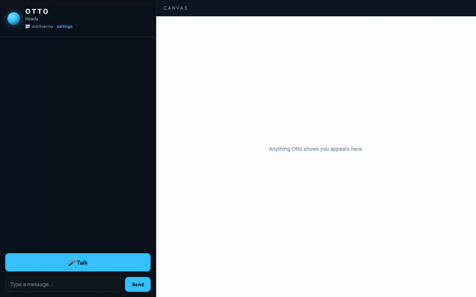

<div align="center">


# Otto

### A voice & a screen for the Claude you already run.

Otto isn't another AI agent — it's the **wiring** (ears, a mouth, a screen, and an
always-on loop) that plugs into the **Claude Code already installed on your Mac** and lets
you *talk* to it. Your MCP servers, subagents, skills, and `CLAUDE.md` — all of it, now by
voice, on a live dashboard.

> **Going commercial:** this project is being productized under the brand **Orrin** (the
> assistant you talk to stays **"Otto"**). Roadmap + decisions in [docs/COMMERCIAL.md](docs/COMMERCIAL.md);
> standalone signed-app build in [packaging/pyinstaller/](packaging/pyinstaller/BUILD.md).
> Source is now **proprietary** — see [LICENSE](LICENSE).



<sub>▶️ [Watch the demo (MP4)](assets/otto-demo.mp4) · idle standby → Otto answers each question **as a canvas visual** (clock, weather scene, diagram) → the ⚙ drawer edits every setting in place.</sub>

</div>

---

## Why Otto

Most voice assistants *are* the brain. Otto is the opposite: it brings the voice and the
screen, and **uses your Claude as the brain** — so whatever you've already set up in Claude
Code just works, spoken.

- 🎙️ **Talk to your own Claude** — click **Talk** (or use the wake word), speak, and Otto
  runs your Claude and answers out loud.
- 🧩 **Inherits everything** — Gmail, Google Drive, GitHub, your files, every MCP connector
  in your Claude — automatically, because Otto loads your Claude config.
- 🖥️ **Canvas-first, like JARVIS** — most answers appear as a **visual on the canvas**: the
  time becomes a clock, weather becomes a scene, "how does X work" becomes a diagram, code
  becomes pseudocode. The full conversation stays tucked in a drawer until you want it.
- ⚙️ **Configure it in place** — the header badge shows your live wake word, and the **⚙
  settings drawer** (same dashboard) switches project and edits voice/brain settings, saved
  straight to `config.yaml`.
- 💬 **Remembers** — the conversation is persisted and replayed when you reopen the dashboard.
- 🍎 **Lives in your menu bar** — installs as a login-item app: project switcher, mute,
  settings, live status (a state-colored icon: grey idle, cyan listening, blue thinking,
  purple speaking, red muted).
- 🔌 **Is itself an MCP for Claude** — `claude mcp add otto` gives *any* Claude session a
  voice and a screen (`speak` / `ask` / `show`).

## Quick start

> 📖 **New here? Follow [INSTALL.md](INSTALL.md) — a complete step-by-step guide anyone can
> follow (~10 min).** The short version:

```bash
git clone https://github.com/dockndevai/otto-assist.git && cd otto-assist
claude                                     # sign in once (or set ANTHROPIC_API_KEY in .env)
bash install.sh                            # one command: sets up, installs & starts Otto
```

`install.sh` does everything end to end — prerequisites, a virtualenv with all
dependencies, the Whisper model, the launchd menu-bar app, the Claude MCP registration —
then **waits until Otto is up and opens the dashboard**. Safe to re-run.

Open http://127.0.0.1:8000 → click **🎤 Talk** and speak, or type. `/demo` renders a
sample canvas without calling the model. Make a custom **"hey otto"** wake word with
`python -m otto.enroll_wake_word "hey otto"`.

## Install with Homebrew

Prefer `brew`? There's a tap ([dockndevai/homebrew-otto](https://github.com/dockndevai/homebrew-otto)).
The app repo is private, so it installs from `main` over your SSH key:

```bash
brew tap dockndevai/otto https://github.com/dockndevai/homebrew-otto.git
brew install --HEAD dockndevai/otto/otto
otto setup                     # one-time: builds the env + downloads Whisper (~few min)
otto start                     # foreground, dashboard at http://127.0.0.1:8000
```

Keep it in your menu bar at login with `brew services start otto`. To make Otto show up in
**Spotlight** (⌘-Space) and be double-clickable, run `otto install-app` — it adds a small
`Otto.app` to `~/Applications`. (You need read access to `dockndevai/otto-assist` and an SSH
key on your GitHub account.)

## Run as an always-on Mac app

`bash install.sh` (above) already does this. To (re)install just the service:

```bash
bash scripts/install_service.sh
```

Installs a launchd login-item, puts a state-colored **🤖** in your menu bar (**Talk · Open
Dashboard · Settings · Project ▸ · Mute · Restart · Quit**), and registers Otto's
voice/screen MCP into your Claude Code. **Quit** fully stops Otto (it unloads the launchd
job, so it won't relaunch); **Restart** reloads a fresh process. Remove entirely with
`bash scripts/uninstall_service.sh`.

## Everything is configurable — from the app

Click the **⚙ gear** on the dashboard (or menu bar → **Settings**) to open the settings
drawer **right on the dashboard** — switch the project Otto is working in, set the wake
word, choose the brain/permissions, and tune voice, then **Save**. It writes
`~/Library/Application Support/Otto/config.yaml`; the header badge updates to your new wake
word immediately (some changes apply after **Restart**).

## Talking to Otto

Four ways in:

1. **🎤 Talk button** *(most reliable)* — dashboard button, menu-bar **Talk to Otto**, or the
   **⌘⇧J** hotkey. Click, then speak — no wake word, no mishearing. Needs no macOS
   permission (the hotkey needs Accessibility).
2. **Always-listen** *(just talk)* — set `voice.stt.always_listen: true` and Otto responds
   to whatever you say, no wake word. It ignores its own voice; **mute the mic** (menu bar)
   when you're not talking to it so it doesn't pick up background chatter.
3. **Wake word** — say your phrase first; hands-free but the software wake word rides on
   speech-to-text which can drop the name (a custom trained model is reliable — see below).
4. **Type** in the dashboard — always works.

Otto **waits for you to finish** (`voice.stt.silence_seconds`, ~1.8s pause) so it won't cut
you off.

### Menu bar — status at a glance

The menu-bar robot changes color to show what Otto is doing:


| Color | State |
|---|---|
| ⚪ **Grey** | Idle — doing nothing |
| 🟢 **Green** | Listening — hearing you |
| 🔵 **Blue** | Thinking / working |
| 🟠 **Orange** | Speaking — replying aloud |
| 🔴 **Red** | Mic muted |

The menu also has **Talk to Otto · Open Dashboard · Settings · Project ▸ · Mute mic / voice ·
Restart · Quit**. It starts at login and restarts on crash.

The menu-bar glyph shows state at a glance: 🧠 idle · 👂 listening · 🗣️ speaking. Otto
**acknowledges before it acts** ("One sec…") so it's never silently working, and reads flow
freely while consequential actions (sending, deleting) ask first.

### Custom wake word — anyone, any phrase (recommended)

Make your **own** wake word by recording it a few times — no account, no training, no Colab
(via few-shot [EfficientWord-Net](https://pypi.org/project/EfficientWord-Net/)):

```bash
python -m otto.enroll_wake_word "hey otto"
```

Say it 4 times when prompted; Otto builds the detector, points its config at it, and
switches to the `efficientword` backend. Restart and say your phrase. Works for *any*
phrase and any user — great for a shareable app.

Other `voice.stt.wakeword_backend` options: **`phrase`** (default, zero-setup software wake
word, but STT can miss the trigger) · **`oww`** ([openWakeWord](https://github.com/dscripka/openWakeWord)
built-ins like "hey jarvis", or a trained model) · **`pvporcupine`**
([Porcupine](https://picovoice.ai/platform/porcupine/), instant but work-email signup).

## What it can do (via your Claude)

Because Otto runs your Claude, it can do anything your Claude can — by voice:

| Say… | Otto… |
|---|---|
| *"check my recent emails"* | searches Gmail, reads a spoken summary |
| *"find my resume in Drive"* | queries Google Drive |
| *"any open PRs?"* | runs `gh` |
| *"what's in my Documents projects?"* | reads your files |
| *"show me a chart of X"* | renders it to the canvas |

## Configuration

Agent behavior (MCP, subagents, skills, `CLAUDE.md`, permissions) comes from **your Claude
config** — not here. Otto's `config.yaml` is wiring only:

| Setting | Default | Notes |
|---|---|---|
| `brain.model` | `""` | blank = Claude's default (e.g. `opus`) |
| `brain.permission` | `voice` | prompts for consequential tools: `voice`/`auto`/`deny` |
| `brain.project_dir` | `~` | current project (the brain's cwd) |
| `brain.continue_conversation` | `true` | resume the project's latest session |
| `voice.stt.always_listen` | `false` | `true` = just talk, no wake word (mute when idle) |
| `voice.stt.silence_seconds` | `1.8` | pause that ends your turn — higher waits longer |
| `voice.stt.wakeword_backend` | `phrase` | `phrase` / `oww` / `pvporcupine` / `efficientword` |
| `voice.tts.engine` | `system` | macOS `say`; `elevenlabs` needs `ELEVENLABS_API_KEY` |

## How Otto compares (2026)

Realtime voice AI splits two ways: **cascaded** (STT→LLM→TTS — transparent, tool-friendly,
frameworks like [Pipecat](https://github.com/pipecat-ai/pipecat) /
[LiveKit Agents](https://github.com/livekit/agents)) and **native speech-to-speech** (OpenAI
Realtime, Gemini Live — lower latency, but the model *is* the brain). **Otto is deliberately
cascaded**, because the point is to wire voice to *your* Claude, not replace it. We
hand-rolled the loop to stay dependency-light and Claude-native; adopting Pipecat later would
be a clean refactor of just `voice/` + `orchestrator.py`.

## Layout

```
run.py                     terminal entrypoint
otto/
  orchestrator.py          realtime loop: ears → brain → mouth, project switching, echo guard
  history.py               persist + replay the dashboard conversation
  projects.py              recent-project discovery (~/.claude/projects)
  config.py                storage (~/Library/Application Support/Otto) + wiring config
  mcpserver.py             Otto-as-MCP for Claude (speak/ask/show/notify/status)
  brain/  agent.py         ClaudeBrain — runs YOUR Claude (setting_sources + preset)
          tools.py         in-process voice/screen tools
  voice/  stt.py tts.py hotkey.py     ears (Whisper) / mouth (say) / push-to-talk
  server/ app.py           FastAPI: dashboard, WebSocket, /api, mounts /mcp
          web/             dashboard + settings UI (no build step)
```

> Not an agent framework: there's no Otto persona, subagents, or connector config — those
> come from your Claude. Otto is the wiring around it.

## Requirements

macOS + [Homebrew](https://brew.sh) · Python 3.11+ · a logged-in `claude` CLI (or
`ANTHROPIC_API_KEY`). Grant **Microphone** (voice) and **Accessibility + Input Monitoring**
(⌘⇧J hotkey) in System Settings.
