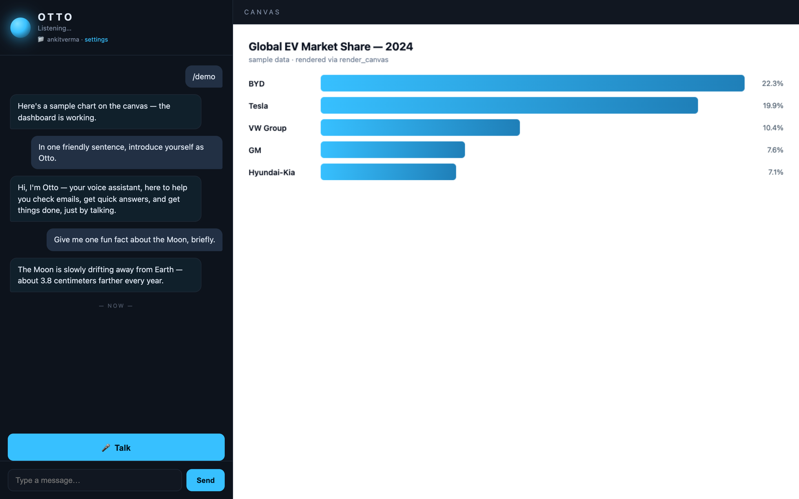
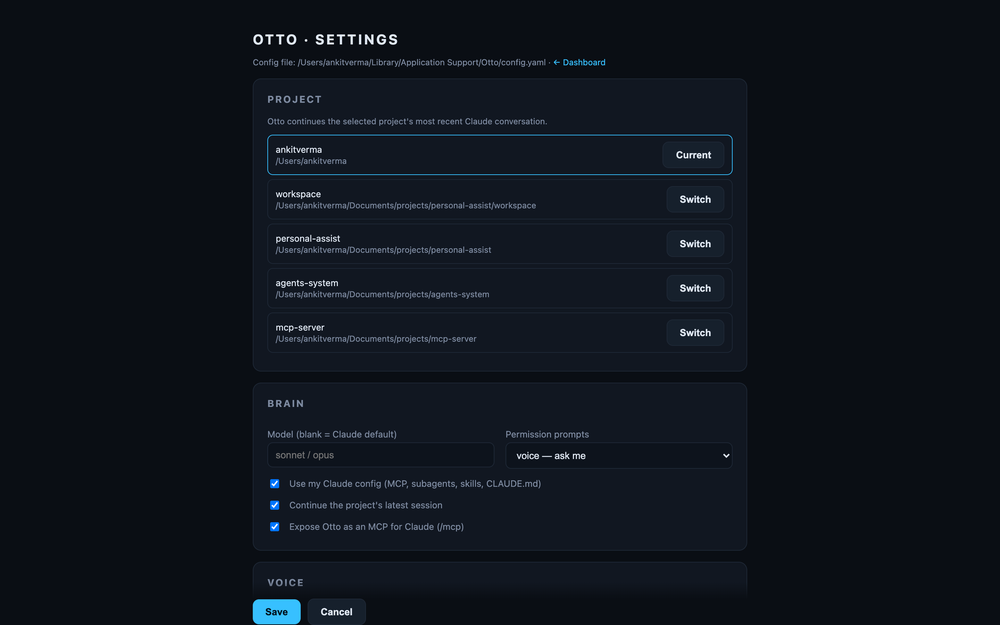

<div align="center">

# 🧠 Otto

### A voice & a screen for the Claude you already run.

Otto isn't another AI agent — it's the **wiring** (ears, a mouth, a screen, and an
always-on loop) that plugs into the **Claude Code already installed on your Mac** and lets
you *talk* to it. Your MCP servers, subagents, skills, and `CLAUDE.md` — all of it, now by
voice, on a live dashboard.



</div>

---

## Why Otto

Most voice assistants *are* the brain. Otto is the opposite: it brings the voice and the
screen, and **uses your Claude as the brain** — so whatever you've already set up in Claude
Code just works, spoken.

- 🎙️ **Talk to your own Claude** — click **Talk** (or use the wake word), speak, and Otto
  runs your Claude and answers out loud.
- 🧩 **Inherits everything** — Gmail, Google Drive, GitHub, your files, every MCP connector
  in your Claude — automatically, because Otto loads your Claude config.
- 🖥️ **Shows you things** — a live transcript plus a **canvas** Otto renders charts, tables,
  and results into (see the chart above — rendered by Claude via a `render_canvas` tool).
- 💬 **Remembers** — the conversation is persisted and replayed when you reopen the dashboard.
- 🍎 **Lives in your menu bar** — installs as a login-item app: project switcher, mute,
  settings, live status.
- 🔌 **Is itself an MCP for Claude** — `claude mcp add otto` gives *any* Claude session a
  voice and a screen (`speak` / `ask` / `show`).

## Quick start

```bash
bash scripts/setup.sh
source .venv/bin/activate
python run.py
```

Open http://127.0.0.1:8000 → click **🎤 Talk** and speak, or type. `/demo` renders the
sample chart above without calling the model.

## Run as an always-on Mac app

```bash
bash scripts/install_service.sh
```

Installs a launchd login-item, puts a **🧠** in your menu bar (**Talk · Open Dashboard ·
Settings · Project ▸ · Mute · Restart · Quit**), and registers Otto's voice/screen MCP into
your Claude Code. Remove with `bash scripts/uninstall_service.sh`.

## Everything is configurable — from the app

Menu bar → **Settings** (or `~/Library/Application Support/Otto/config.yaml`): pick the
project Otto is working in, choose the brain/permissions, and tune voice — no editing code.



## Talking to Otto

Three ways in, most-to-least reliable:

1. **🎤 Talk button** *(recommended)* — dashboard button, menu-bar **Talk to Otto**, or the
   **⌘⇧J** hotkey. Click, then speak — no wake word, no mishearing. Needs no macOS
   permission (the hotkey needs Accessibility).
2. **Wake word "hey otto"** — hands-free, but it rides on speech-to-text which can drop the
   name; a trained model fixes that (see below).
3. **Type** in the dashboard — always works.

The menu-bar glyph shows state at a glance: 🧠 idle · 👂 listening · 🗣️ speaking. Otto
**acknowledges before it acts** ("One sec…") so it's never silently working, and reads flow
freely while consequential actions (sending, deleting) ask first.

### Wake word

`voice.stt.wakeword_backend`:
- **`phrase`** (default) — software wake word, any phrase, no account. Convenient but
  limited by STT dropping the trigger.
- **`oww`** — [openWakeWord](https://github.com/dscripka/openWakeWord): built-ins work out
  of the box; a robust custom **"hey otto"** needs a free trained model — see
  [docs/HEY_OTTO.md](docs/HEY_OTTO.md), then `bash scripts/install_wake_word.sh model.onnx`.
- **`pvporcupine`** — [Porcupine](https://picovoice.ai/platform/porcupine/): instant custom
  keywords (signup needs a work email).

## What it can do (via your Claude)

Because Otto runs your Claude, it can do anything your Claude can — by voice:

| Say… | Otto… |
|---|---|
| *"check my recent emails"* | searches Gmail, reads a spoken summary |
| *"find my resume in Drive"* | queries Google Drive |
| *"any open PRs?"* | runs `gh` |
| *"what's in my Documents projects?"* | reads your files |
| *"show me a chart of X"* | renders it to the canvas |

## Configuration

Agent behavior (MCP, subagents, skills, `CLAUDE.md`, permissions) comes from **your Claude
config** — not here. Otto's `config.yaml` is wiring only:

| Setting | Default | Notes |
|---|---|---|
| `brain.model` | `""` | blank = Claude's default (e.g. `opus`) |
| `brain.permission` | `voice` | prompts for consequential tools: `voice`/`auto`/`deny` |
| `brain.project_dir` | `~` | current project (the brain's cwd) |
| `brain.continue_conversation` | `true` | resume the project's latest session |
| `voice.stt.wakeword_backend` | `phrase` | `phrase` / `oww` / `pvporcupine` |
| `voice.tts.engine` | `system` | macOS `say`; `elevenlabs` for a premium voice |

## How Otto compares (2026)

Realtime voice AI splits two ways: **cascaded** (STT→LLM→TTS — transparent, tool-friendly,
frameworks like [Pipecat](https://github.com/pipecat-ai/pipecat) /
[LiveKit Agents](https://github.com/livekit/agents)) and **native speech-to-speech** (OpenAI
Realtime, Gemini Live — lower latency, but the model *is* the brain). **Otto is deliberately
cascaded**, because the point is to wire voice to *your* Claude, not replace it. We
hand-rolled the loop to stay dependency-light and Claude-native; adopting Pipecat later would
be a clean refactor of just `voice/` + `orchestrator.py`.

## Layout

```
run.py                     terminal entrypoint
otto/
  orchestrator.py          realtime loop: ears → brain → mouth, project switching, echo guard
  history.py               persist + replay the dashboard conversation
  projects.py              recent-project discovery (~/.claude/projects)
  config.py                storage (~/Library/Application Support/Otto) + wiring config
  mcpserver.py             Otto-as-MCP for Claude (speak/ask/show/notify/status)
  brain/  agent.py         ClaudeBrain — runs YOUR Claude (setting_sources + preset)
          tools.py         in-process voice/screen tools
  voice/  stt.py tts.py hotkey.py     ears (Whisper) / mouth (say) / push-to-talk
  server/ app.py           FastAPI: dashboard, WebSocket, /api, mounts /mcp
          web/             dashboard + settings UI (no build step)
```

> Not an agent framework: there's no Otto persona, subagents, or connector config — those
> come from your Claude. Otto is the wiring around it.

## Requirements

macOS + [Homebrew](https://brew.sh) · Python 3.11+ · a logged-in `claude` CLI (or
`ANTHROPIC_API_KEY`). Grant **Microphone** (voice) and **Accessibility + Input Monitoring**
(⌘⇧J hotkey) in System Settings.
