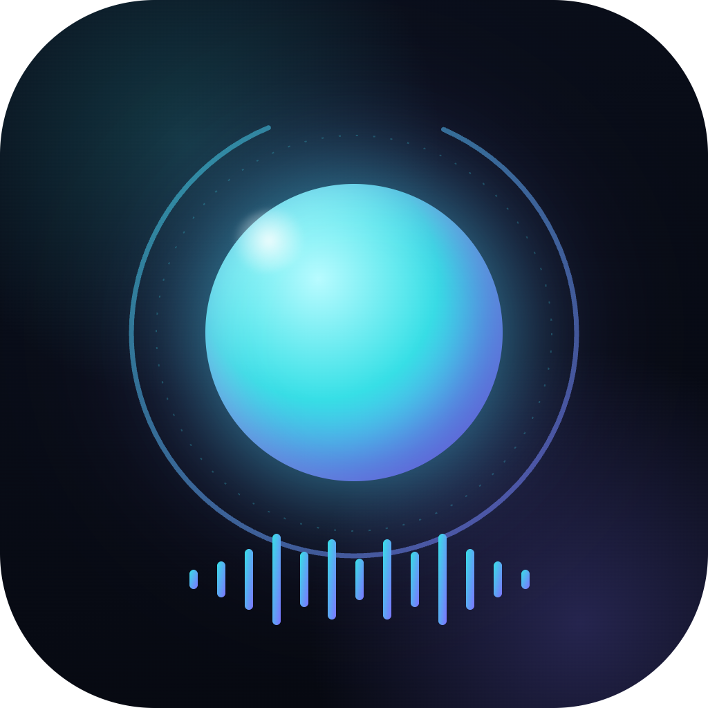
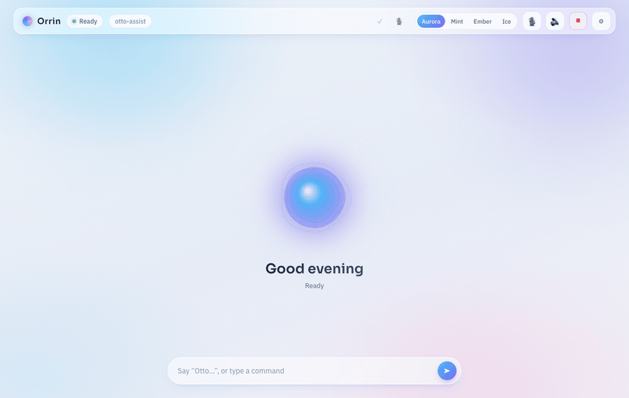
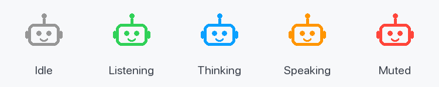

<div align="center">



# Orrin

### A voice & a screen for the Claude you already run.

Orrin isn't another AI agent — it's the **wiring** (ears, a mouth, a screen, and an
always-on loop) that plugs into the **Claude Code already installed on your Mac** and lets
you *talk* to it. Your MCP servers, subagents, skills, and `CLAUDE.md` — all of it, now by
voice, on a live dashboard.

> **Orrin** is the app you install. **"Otto"** is the wake word — who you call across the
> room. The name is yours to change.
>
> Productization notes in [docs/COMMERCIAL.md](docs/COMMERCIAL.md); the standalone signed-app
> build in [packaging/pyinstaller/BUILD.md](packaging/pyinstaller/BUILD.md) and
> [SIGNING.md](packaging/pyinstaller/SIGNING.md). Source license — see [LICENSE](LICENSE).



<sub>▶️ [Watch the demo (MP4)](assets/orrin-demo.mp4) · say **"Otto"** → the orb goes listening → thinking → speaking; the answer lands on the dashboard (real weather, GitHub activity, charts), the transcript streams in the Chat drawer, and ☀️/🌙 flips the theme.</sub>

</div>

---

## Why Orrin

Most voice assistants *are* the brain. Orrin is the opposite: it brings the voice and the
screen, and **uses your Claude as the brain** — so whatever you've already set up in Claude
Code just works, spoken.

- 🎙️ **Talk to your own Claude** — say the wake word (or click **Talk**), speak, and Orrin
  runs your Claude and answers out loud.
- 🧩 **Inherits everything** — Gmail, Google Drive, GitHub, your files, every MCP connector,
  subagent and skill in your Claude — automatically, because Orrin loads your Claude config.
- 🖥️ **A live dashboard** — a product-grade layout: a **sidebar** (Home / Conversations /
  Visuals / Skills / MCP Connectors / Settings), a **weather hero** with real conditions +
  air quality, **GitHub-activity** and **quick-action** widgets, a right **Chat drawer**
  ("Ask Orrin anything"), a floating **listening bar**, and a bottom **status bar** (Claude
  Code · MCP · Mode · TTS · version). Cards appear only when they have data — no empty boxes.
- 🎨 **Light or dark, with a mood** — full theme toggle (system-aware), and a **mood color**
  (green / blue / red) that tints the orb by severity, automatically or set by Orrin.
- 🗣️ **Reliable, hands-free voice** — strict half-duplex (it mutes the mic while it speaks, so
  it never answers its own voice), **sleep/wake** ("stop listening" → the wake word brings it
  back), and **pick any macOS voice** with a live ▶ preview in Settings.
- 💬 **Every chat, every project** — switch projects *and* individual Claude chats by voice or
  from the UI; an **All projects** search spans every session on the machine (cowork included)
  and resumes the one you pick.
- 🍎 **Lives in your menu bar** — a login-item app with a state-colored icon (grey idle, cyan
  listening, blue thinking, purple speaking, red muted), project/chat switcher, mute, restart.
- ✅ **Tells you when it's ready** — a first-run setup checklist (Microphone, Claude CLI, a
  real **Claude test turn**, Voice output, Accessibility) with Open Settings / Recheck, and a
  ✓ Ready pill. It re-runs on every launch, so a missing permission is visible, not silent.
- 🔌 **Is itself an MCP for Claude** — `claude mcp add otto` gives *any* Claude session a
  voice and a screen (`speak` / `ask` / `show`).

## Get Orrin

### Option A — download the app (fastest)

Grab **`Orrin.dmg`** from the [latest release](https://github.com/dockndevai/otto-assist/releases/latest),
open it, and drag **Orrin** to **Applications**.

> The public DMG isn't notarized yet, so the first launch needs **right-click → Open** to get
> past Gatekeeper, and macOS will ask for **Microphone** access once. For the most reliable
> voice capture today, use the from-source install below; a fully notarized, permission-stable
> build is wired and waiting on Apple Developer enrollment — see
> [SIGNING.md](packaging/pyinstaller/SIGNING.md).

### Option B — install from source (recommended for voice)

> 📖 **New here? Follow [INSTALL.md](INSTALL.md) — a complete step-by-step guide (~10 min).**

```bash
git clone https://github.com/dockndevai/otto-assist.git && cd otto-assist
claude                                     # sign in once (or set ANTHROPIC_API_KEY in .env)
bash install.sh                            # one command: sets up, installs & starts Orrin
```

`install.sh` does everything end to end — prerequisites, a virtualenv with all
dependencies, the Whisper model, the launchd menu-bar app, the Claude MCP registration —
then **waits until Orrin is up and opens the dashboard**. Safe to re-run.

Open http://127.0.0.1:8000 → click **🎤 Talk** and speak, or type. `/demo` renders a
sample visual without calling the model. Make a custom **"hey otto"** wake word with
`python -m otto.enroll_wake_word "hey otto"`.

### Option C — Homebrew

Prefer `brew`? There's a tap ([dockndevai/homebrew-otto](https://github.com/dockndevai/homebrew-otto)).
The app repo is private, so it installs from `main` over your SSH key:

```bash
brew tap dockndevai/otto https://github.com/dockndevai/homebrew-otto.git
brew install --HEAD dockndevai/otto/otto
otto setup                     # one-time: builds the env + downloads Whisper (~few min)
otto start                     # foreground, dashboard at http://127.0.0.1:8000
```

Keep it in your menu bar at login with `brew services start otto`. To make Orrin show up in
**Spotlight** (⌘-Space) and be double-clickable, run `otto install-app` — it adds a small
`Orrin.app` to `~/Applications`. (You need read access to `dockndevai/otto-assist` and an SSH
key on your GitHub account.)

## Run as an always-on Mac app

`bash install.sh` (above) already does this. To (re)install just the service:

```bash
bash scripts/install_service.sh
```

Installs a launchd login-item, puts a state-colored **🤖** in your menu bar (**Talk · Open
Dashboard · Settings · Project ▸ · Mute · Restart · Quit**), and registers Orrin's
voice/screen MCP into your Claude Code. **Quit** fully stops Orrin (it unloads the launchd
job, so it won't relaunch); **Restart** reloads a fresh process. Remove entirely with
`bash scripts/uninstall_service.sh`.

## Everything is configurable — from the app

Open **Settings** in the sidebar (or menu bar → **Settings**) to switch the project Orrin is
working in, set the wake word, choose the brain/permissions, **pick any installed macOS voice**
(with a ▶ preview), and tune the rest, then **Save**. It writes
`~/Library/Application Support/Otto/config.yaml`; most changes apply live (some after
**Restart**).

## Talking to Orrin

Four ways in:

1. **🎤 Talk button** *(most reliable)* — dashboard button or menu-bar **Talk to Orrin**: click,
   then speak — no wake word, no mishearing, no macOS permission needed. There's also an opt-in
   global **⌘⇧J** hotkey (`voice.hotkey.enabled`) that works in the packaged app — it's a
   main-thread key monitor and needs **Input Monitoring** permission.
2. **Always-listen** *(just talk)* — set `voice.stt.always_listen: true` and Orrin responds
   to whatever you say, no wake word. It mutes the mic while it speaks (no self-echo); say
   **"stop listening"** to put it to sleep, and the **wake word** wakes it again.
3. **Wake word** — say your phrase first; hands-free but the software wake word rides on
   speech-to-text which can drop the name (a custom trained model is reliable — see below).
4. **Type** in the Chat drawer — always works.

Orrin **waits for you to finish** (`voice.stt.silence_seconds`, ~1.3s pause) so it won't cut
you off.

**Dictation-anywhere** — flip on **Dictation mode** (menu bar, or say *"start dictation"*) and
Orrin types what you say into whatever app is focused (⌘V, and it restores your clipboard),
instead of talking to Claude. Say *"stop dictation"* to switch back. Optionally turn on
`voice.stt.refine` to strip "ums" and false starts before the text is inserted.

Every utterance Orrin hears is also logged per project (**Captures**, `GET /api/captures`), so
you can review what it heard — handy for catching mis-hears in always-listen mode. And each
project can have **its own voice** (`voice.tts.project_voices`) so parallel workspaces are easy
to tell apart by ear.

### Menu bar — status at a glance

The menu-bar robot changes color to show what Orrin is doing:



| Color | State |
|---|---|
| ⚪ **Grey** | Idle — doing nothing |
| 🟢 **Green** | Listening — hearing you |
| 🔵 **Blue** | Thinking / working |
| 🟠 **Orange** | Speaking — replying aloud |
| 🔴 **Red** | Mic muted |

The menu also has **Talk to Orrin · Open Dashboard · Settings · Project ▸ · Mute mic / voice ·
Restart · Quit**. It starts at login and restarts on crash. Orrin **acknowledges before it
acts** ("One sec…") so it's never silently working, and reads flow freely while consequential
actions (sending, deleting) ask first.

### Custom wake word — anyone, any phrase (recommended)

Make your **own** wake word by recording it a few times — no account, no training, no Colab
(via few-shot [EfficientWord-Net](https://pypi.org/project/EfficientWord-Net/)):

```bash
python -m otto.enroll_wake_word "hey otto"
```

Say it 4 times when prompted; Orrin builds the detector, points its config at it, and
switches to the `efficientword` backend. Restart and say your phrase. Works for *any*
phrase and any user — great for a shareable app.

Other `voice.stt.wakeword_backend` options: **`phrase`** (default, zero-setup software wake
word, but STT can miss the trigger) · **`oww`** ([openWakeWord](https://github.com/dscripka/openWakeWord)
built-ins like "hey jarvis", or a trained model) · **`pvporcupine`**
([Porcupine](https://picovoice.ai/platform/porcupine/), instant but work-email signup).

## What it can do (via your Claude)

Because Orrin runs your Claude, it can do anything your Claude can — by voice:

| Say… | Orrin… |
|---|---|
| *"what's the weather and my GitHub activity?"* | shows the live weather hero + GitHub card |
| *"check my recent emails"* | searches Gmail, reads a spoken summary |
| *"find my resume in Drive"* | queries Google Drive |
| *"in the clickhouse project, check git status"* | runs it in that project in the background |
| *"show me a chart of my last five commits"* | renders it to the Visuals canvas |

## Configuration

Agent behavior (MCP, subagents, skills, `CLAUDE.md`, permissions) comes from **your Claude
config** — not here. Orrin's `config.yaml` is wiring only:

| Setting | Default | Notes |
|---|---|---|
| `brain.model` | `""` | blank = Claude's default (e.g. `opus`) |
| `brain.permission` | `voice` | prompts for consequential tools: `voice`/`auto`/`deny` |
| `brain.project_dir` | `~` | current project (the brain's cwd) |
| `brain.continue_conversation` | `false` | resume the project's latest session |
| `voice.stt.always_listen` | `false` | `true` = just talk, no wake word (say "stop listening" to sleep) |
| `voice.stt.silence_seconds` | `1.3` | pause that ends your turn — higher waits longer |
| `voice.stt.refine` | `false` | clean filler/false-starts from the transcript first (cheap model) |
| `voice.stt.dictation_mode` | `false` | type speech into the focused app (⌘V) instead of Claude |
| `voice.stt.wakeword_backend` | `phrase` | `phrase` / `oww` / `pvporcupine` / `efficientword` |
| `voice.stt.realtime_partials` | `false` | live partial captions as you speak (small model) |
| `voice.tts.engine` | `system` | macOS `say`; **`kokoro`** = local neural voice (offline, no key — see below); `elevenlabs` = cloud (needs `ELEVENLABS_API_KEY`) |
| `memory.enabled` | `true` | persistent cross-session memory (see below) |
| `memory.auto_capture` | `true` | after each turn, learn what's worth remembering — automatic |
| `memory.max_preamble_chars` | `2000` | cap on the durable-context block injected per turn |

## A better voice (optional) — local & offline

The default voice is macOS `say` (robotic but zero-setup). For a much more natural voice that
still runs **entirely on your Mac** (no API key, no cloud), switch on **Kokoro** — a small 82M
neural TTS:

```bash
pip install -e ".[neural-voice]"        # kokoro-onnx + soundfile (espeak-ng ships bundled)
python -m otto.voice.fetch_kokoro       # downloads the model files (~330 MB) once
```

Then set `voice.tts.engine: kokoro` in Settings (pick a voice like `af_heart`) and restart. If
the package or model files are missing, Orrin logs how to get them and keeps using `say` — it
never goes silent. `elevenlabs` (cloud, premium) remains available with `ELEVENLABS_API_KEY`.

## Memory — it remembers across sessions

Orrin keeps a persistent, shared knowledge store under
`~/Library/Application Support/Otto/memory/` that **every** session reads and writes, so what
it learns in one conversation carries into the next — organized **per project**, with a
**global** tier for facts about you that span all projects:

```
memory/
  global.md              facts about you (all projects)
  index.json             registry of projects Orrin has worked in
  projects/<slug>/
    project.md           curated knowledge about this project
    summary.md           rolling one-line summaries of recent conversations
    turns.jsonl          durable log of every exchange
    history.jsonl        the dashboard conversation (replayed per project)
    docs/                documents you asked Orrin to remember (+ an index)
```

Three things make it feel like memory, not just storage:

- **Always in view** — before each turn, a small **bounded** block (your durable facts + this
  project's facts + the recent summary) is prepended to what Orrin sends Claude, so continuity
  is automatic without stuffing an unbounded transcript into the context window.
- **Learns on its own** — after each turn, a fast background pass decides what's worth keeping
  and folds it into the store. No "remember this" needed (though you can just say it — *"Otto,
  remember that we deploy from the release branch"*).
- **Remembers documents** — say *"remember this doc"* (or point Orrin at a file) and it saves
  the content into the project's memory; relevant saved notes are surfaced automatically when a
  later question matches them (keyword retrieval, no external service), and Claude can open a
  saved note **in full** on demand (its memory dir is added to its readable dirs).

The dashboard replays each **project's own** conversation history — on load and when you switch
projects — and the full turn-by-turn transcript of a chat stays owned by Claude Code itself
(Orrin resumes the project's session); this store adds the curated, cross-session, cross-project
layer on top. Turn it off (or tune it) under `memory:` in `config.yaml`.

It's built to stay cheap: the preamble is re-injected only on a chat's first turn or when the
remembered content actually changes (not redundantly every turn); the learn pass runs in the
background off the voice path, skips greetings, and won't pile up; and document search ranks on
an in-memory index, reading only the top matches.

## How Orrin compares (2026)

Realtime voice AI splits two ways: **cascaded** (STT→LLM→TTS — transparent, tool-friendly,
frameworks like [Pipecat](https://github.com/pipecat-ai/pipecat) /
[LiveKit Agents](https://github.com/livekit/agents)) and **native speech-to-speech** (OpenAI
Realtime, Gemini Live — lower latency, but the model *is* the brain). **Orrin is deliberately
cascaded**, because the point is to wire voice to *your* Claude, not replace it. We
hand-rolled the loop to stay dependency-light and Claude-native; adopting Pipecat later would
be a clean refactor of just `voice/` + `orchestrator.py`.

## Layout

```
run.py                     terminal entrypoint
otto/
  orchestrator.py          realtime loop: ears → brain → mouth, project/chat switching,
                           sleep/wake, half-duplex mute, mood
  preflight.py             first-run permission checks + "Orrin ready" health (mic, Claude
                           test turn, voice, Accessibility)
  history.py               persist + replay the dashboard conversation
  memory.py                persistent cross-session memory (per-project facts + summaries)
  projects.py sessions.py  project + Claude-session (chat) discovery across ~/.claude
  config.py                storage (~/Library/Application Support/Otto) + wiring config
  menubar.py               rumps menu-bar app (state icon, main-thread mic request)
  mcpserver.py             Orrin-as-MCP for Claude (speak/ask/show/notify/status)
  brain/  agent.py         ClaudeBrain — runs YOUR Claude (setting_sources + preset)
          tools.py         in-process voice/screen/mood tools
  voice/  stt.py tts.py hotkey.py     ears (Whisper) / mouth (say, any voice) / push-to-talk
  server/ app.py           FastAPI: dashboard, WebSocket, /api, mounts /mcp
          data.py          live data — weather/AQI, GitHub activity, MCP count (no keys)
          web/             dashboard + settings UI (no build step)
packaging/pyinstaller/     standalone Orrin.app + Orrin.dmg (sign + notarize when configured)
```

> Not an agent framework: there's no Orrin persona, subagents, or connector config — those
> come from your Claude. Orrin is the wiring around it.

## Requirements

macOS 12+ (Apple silicon) + [Homebrew](https://brew.sh) · Python 3.11+ · a logged-in
`claude` CLI (or `ANTHROPIC_API_KEY`). Grant **Microphone** (voice) and **Accessibility +
Input Monitoring** (⌘⇧J hotkey) in System Settings — the first-run checklist walks you
through it.
